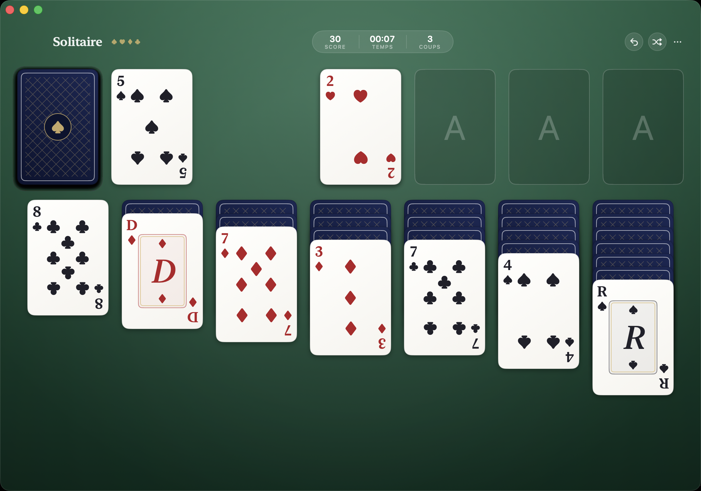

# Solitaire


A beautiful, native Klondike solitaire game for macOS. 100 % SwiftUI — every card is drawn in code (classic pip layouts, ornate face cards, navy lattice card backs), laid on a felt-gradient table.



## Install

Download the latest notarized DMG from [Releases](https://github.com/vincentlauriat/Solitaire/releases), open it and drag **Solitaire.app** to Applications.

## Features

| Feature | Status |
|---|---|
| Klondike rules (draw 1 or draw 3) | ✅ |
| Custom drag & drop with multi-card stacks | ✅ |
| Double-click auto-move to foundations | ✅ |
| Animated card dealing & 3D card flips | ✅ |
| Standard scoring, timer, move counter | ✅ |
| Unlimited undo (⌘Z) | ✅ |
| Auto-complete when the board is open | ✅ |
| Victory confetti | ✅ |

## Build

Requirements: macOS 14+, Xcode 15+, [xcodegen](https://github.com/yonaskolb/XcodeGen).

```bash
xcodegen generate
xcodebuild -scheme Solitaire -configuration Release build
```

## Project layout

```
Solidaire/
├── project.yml              # xcodegen project definition
├── Scripts/
│   ├── make-app-icon.swift  # Generates the icon set (cards on felt)
│   └── release.sh           # Sign + notarize + DMG pipeline
└── Solitaire/
    ├── SolitaireApp.swift   # App entry, window, menu commands
    ├── Models/              # Card, Klondike engine (rules, score, undo)
    ├── Design/              # Theme, card rendering, felt, confetti
    └── Views/               # GameView (board layout, drag & drop)
```

## Controls

- **Click stock** — draw; click again when empty to recycle
- **Drag** — move cards / stacks between piles
- **Double-click** — send a card to its foundation
- **⌘N** — new game · **⌘Z** — undo
- **⋯ menu** — toggle draw-3 mode

## Roadmap

- [x] App icon + notarized DMG release
- [ ] Sounds
- [ ] Other variants (Spider, FreeCell)
